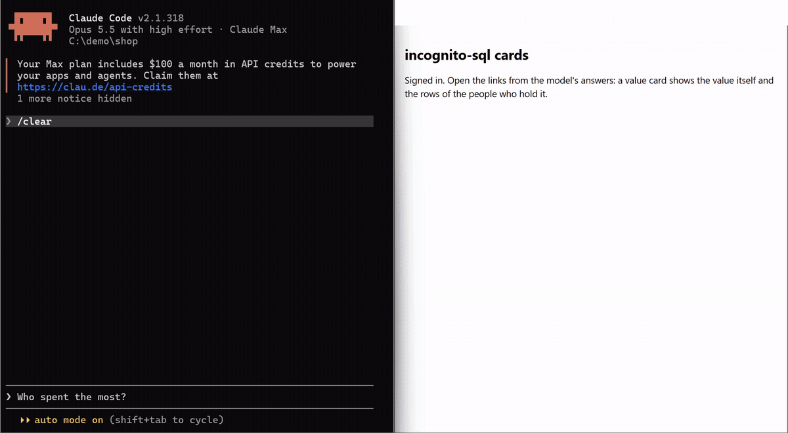
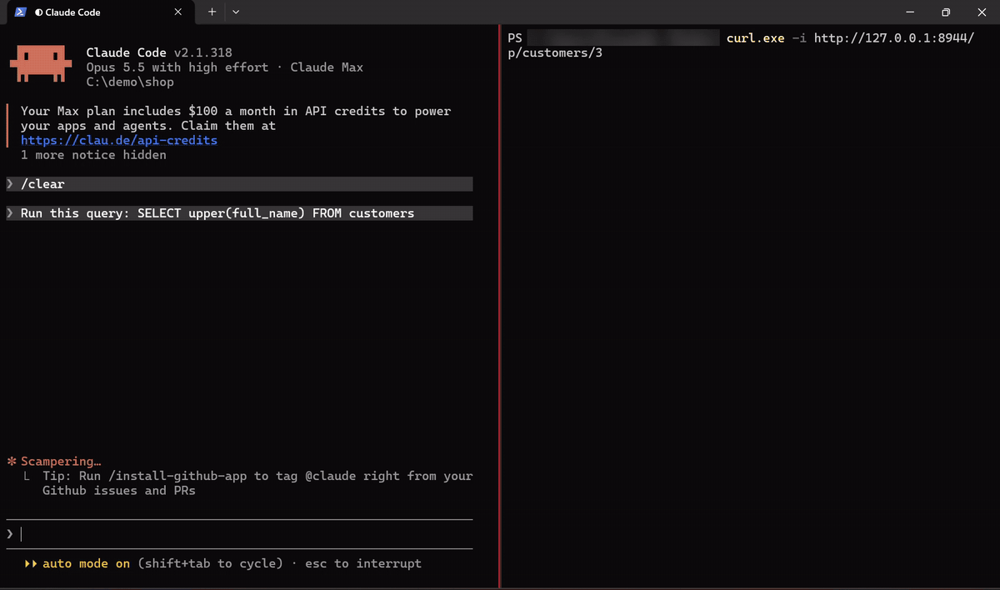

# incognito-sql

**Let your AI agent query a database of personal data — without ever receiving the personal data.**

[](https://pypi.org/project/incognito-sql/)
[](https://github.com/khodossss/incognito-sql/actions/workflows/ci.yml)
[](LICENSE)




incognito-sql is an MCP server for Claude Code, Codex, Cursor and OpenCode. Your agent
writes ordinary SQL. Every name, phone number, e-mail or ID you declare comes back as a
token: the agent can still join, group, count and filter on it, and you click it to see
the real value. The model never can.

## What the model sees

```sql
SELECT c.full_name, c.city, SUM(o.total) AS spent
FROM customers c JOIN orders o ON o.customer_id = c.id
GROUP BY c.full_name, c.city ORDER BY spent DESC
```

| | full_name | city | spent |
|---|---|---|---|
| **in your database** | Mira Quellbrandt | Tellport | 320.5 |
| **what the model gets** | `http://127.0.0.1:8765/v/tk_xpdi6slbwnqe42nn` | Tellport | 320.5 |

The right answer, and the name never left the database. Ask for the value in another
shape and the query is refused before it runs, not filtered afterwards:

```sql
SELECT upper(full_name) FROM customers           -- {"error": "pii_operation"}
SELECT substr(full_name, 1, 3) FROM customers    -- {"error": "pii_operation"}
```

**Can the agent just open the link?** No. A card opens only in a browser you signed in
yourself with `incognito-sql login`; without that sign-in the card server answers `401`
and shows nothing, so an agent that fetches the link gets no value. No tool turns a token
back into a value either. The exceptions are an agent that drives your own browser or runs
commands as your OS user: see [Limits](#limits--read-before-relying-on-it).



## Why it's different

Most guards mask what *looks* personal in the answer, or scan the query for keywords.
Both miss a value reshaped on the way out: upper-cased, sliced, hex-encoded,
concatenated, renamed by an alias.

- **Decides before the query runs.** Every output and comparison is traced to its base
  columns; anything that could carry a hidden value out is refused. Only SQL regenerated
  from the checked query runs — never the model's text.
- **Identifiers stay useful.** The same value is the same token in every answer, so the
  agent can still join, group, count distinct and follow up.
- **Humans see values; models don't.** A token opens as a card in your own browser,
  behind a sign-in.
- **You choose the trade-off.** `strict`, `balanced` or `permissive`, per database or per
  column.
- **Five databases, one set of rules:** PostgreSQL, MySQL, SQL Server, SQLite, DuckDB.

## Benchmark

We ran every open-source tool of this kind we could find on public datasets we did not
write: Spider and BIRD (honest analytics questions) and SecureSQL (attacks). An oracle
that shares no code with the server judged every answer.

| | Attacks that leaked a hidden value | Slicing queries that leaked a whole value | Spider + BIRD questions answered |
|---|---|---|---|
| **incognito-sql** | **0%** | **0%** | **88.7%** |
| **Leak nothing, answer half** — datacharter | 0% | 0% | 45% |
| **Block attacks, leak to slicing** — db-mcp-server, dbridge-mcp, gate, safedb-mcp | 0–7% | 25–56% | 70–76% |
| **Answer almost everything, leak a little** — veil | 7% | 7% | 97% |
| **Answer most, leak a lot** — januscope, mcp-server-conceal | 33–38% | 44–53% | 85–95% |
| **Leak a lot, answer less** — dbmcp | 32% | 29% | 62% |
| plain read-only SQL | 47% | 56% | 100% |

*Slicing:* asking for a hidden value in pieces — its head, its tail, `MIN` / `MAX`.
Of these tools, only incognito-sql and datacharter keep the promise in their own README.

On our own attack corpus across all five databases, **0 of 2,894 attacks** showed a
hidden value (plain read-only SQL: 17.5%).

Run of 3 November 2026, default `permissive` profile. Method, every number and known
limits: [docs/benchmark.md](docs/benchmark.md).

## Quick start

**1. Give your agent the plugin**, then restart the client:

```sh
# Claude Code
claude plugin marketplace add khodossss/incognito-sql
claude plugin install incognito-sql@incognito-sql
# Codex
codex plugin marketplace add khodossss/incognito-sql
codex plugin add incognito-sql@incognito-sql
```

OpenCode: `uvx incognito-sql skill opencode`. Any other client: ask the agent to set up
incognito-sql, and it follows `incognito-sql guide`.

**2. Ask your agent:**

> *Show me incognito-sql on the demo.*

It creates a shop of invented customers and connects to it. Now ask *"who spent the
most?"*: the names come back as links that only you can open.

> *Connect my database through incognito-sql.*

It reads your schema, goes through the columns with you and writes the declaration.
Nothing needs a restart. The database password is the one step that stays yours: the
agent prints the command, and you run it in your own terminal.

**Without an agent:** `pip install "incognito-sql[mcp,postgres]"`, then
[docs/setup.md](docs/setup.md).

## How it works

1. **Declare** each column once in YAML: `identifier` (token), `open`, `open_quasi`,
   `closed`, `closed_hidden`. An unlisted column is hidden. `incognito-sql init` drafts
   the file from your schema.
2. **Check.** The query is parsed and every column traced; anything not allowed is
   refused with a reason and a hint the agent can act on.
3. **Regenerate.** Only fresh SQL built from the checked query runs, read-only, with
   bound parameters.
4. **Shape.** Identifiers become tokens; any other cell that looks personal (e-mail,
   phone, card, IBAN) is masked too.

Also included: `assess` measures what your profile actually holds on your own data,
`report` gives your DPO a per-column summary, and the audit log is tamper-evident.

## Choose a profile

| Profile | What the model may learn about a hidden value | Good for |
|---|---|---|
| `strict` | only whether a value you typed exists | health, finance, regulated data |
| `balanced` | the same, with fewer needless refusals | CRM, orders, internal analytics |
| `permissive` (default) | also its order, length, prefix and substring | prototypes, your own data |

No profile ever shows a value whole. For real customers' data, choose `balanced` or
`strict` on purpose. Details: [docs/configuration.md](docs/configuration.md).

## Limits — read before relying on it

- **MVP, not independently audited.** Found a leak? Report it privately:
  [SECURITY.md](SECURITY.md).
- **Pseudonymization, not anonymization.** City + birth date + postcode can still single
  someone out.
- **An agent with a shell on the same OS account can bypass the server** — read the
  database password, or sign in to the cards itself. For other people's data, use the
  closed profile: [docs/deployment.md](docs/deployment.md).
- **An agent that drives your browser sees the cards you open.** Don't let it use the
  browser you open cards in.
- **Parsing is the boundary.** Tests and benchmarks measure leaks; they don't prove
  there are none.

Full threat model: [docs/threat-model.md](docs/threat-model.md).

## Docs

[Setup](docs/setup.md) · [Configuration & profiles](docs/configuration.md) ·
[Benchmark](docs/benchmark.md) · [Threat model](docs/threat-model.md) ·
[Deployment](docs/deployment.md) · [Changelog](CHANGELOG.md)

## License

Apache-2.0. Attribution of the benchmark corpora: [NOTICE](NOTICE).
